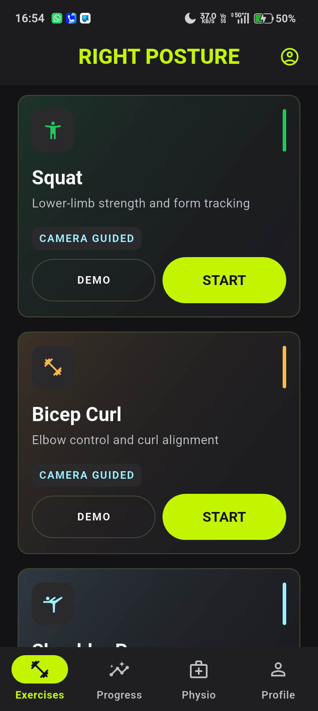
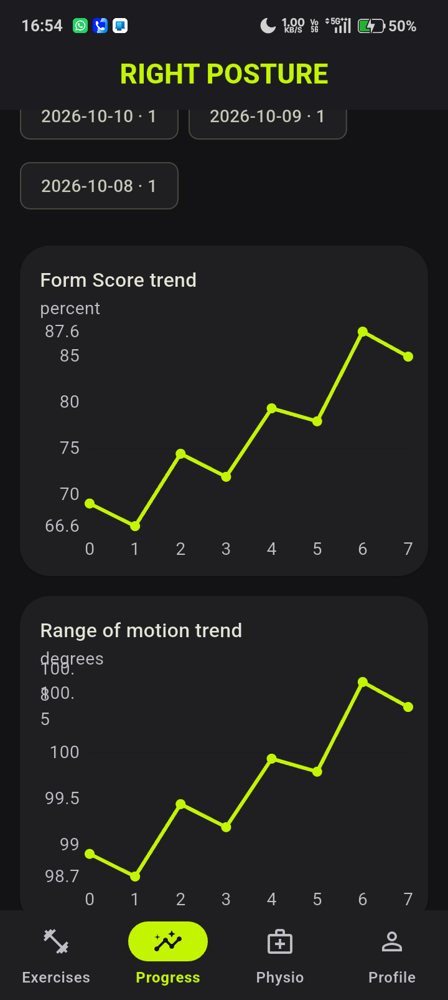
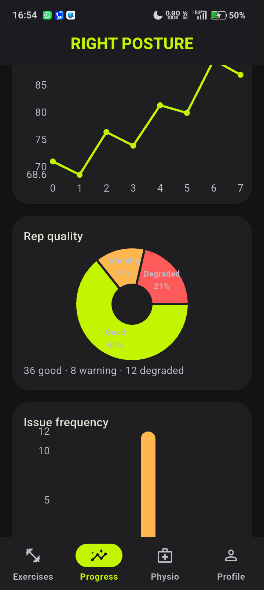
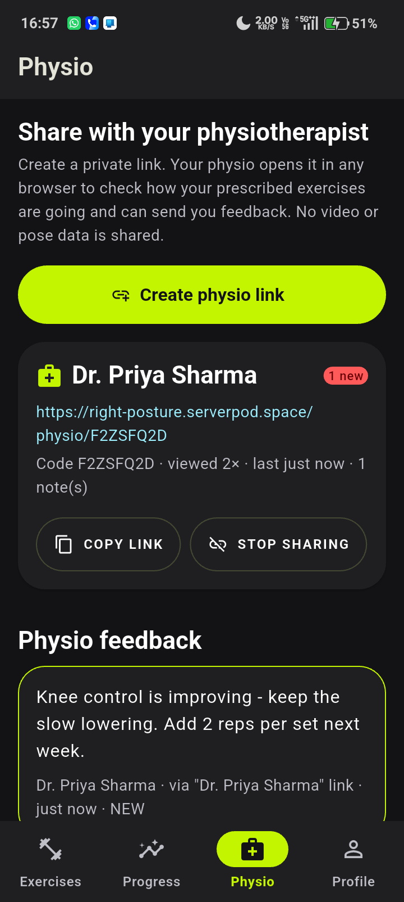
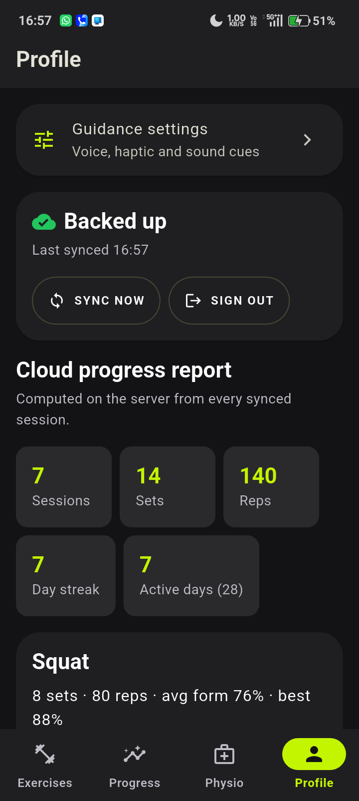
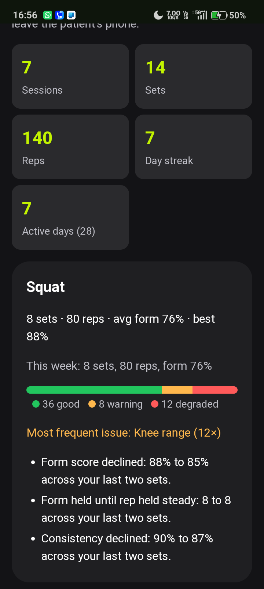
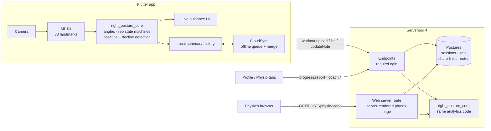

# Right Posture

### Home physiotherapy, guided by your phone and connected to your physio, with a Serverpod backend.

<table align="center">
  <tr>
    <td align="center"><br><sub><b>Exercises</b><br>Camera-guided prescribed exercises</sub></td>
    <td align="center"><br><sub><b>Progress</b><br>Form score trend across sessions</sub></td>
    <td align="center"><br><sub><b>Rep quality</b><br>Good / warning / degraded reps</sub></td>
  </tr>
  <tr>
    <td align="center"><br><sub><b>Physio</b><br>Share a link, read feedback</sub></td>
    <td align="center"><br><sub><b>Profile</b><br>Report computed by Serverpod</sub></td>
    <td align="center"><br><sub><b>Physio's browser</b><br>Served by Serverpod</sub></td>
  </tr>
</table>
<p align="center"><sub>Screenshots use fictional demo sessions.</sub></p>

After a physiotherapy appointment, most of the recovery work happens at home: the exercises your physio prescribed, done alone and without feedback. Right Posture uses only the phone camera to watch those exercises. It turns 33 body landmarks into joint angles, counts reps, and gives live, evidence-based form cues. It also catches form slowly getting worse as the patient tires, not just reps that are plainly wrong.

**Serverpod connects the patient and the physiotherapist.** Sessions sync to a Postgres-backed history, the server computes a progress report, and the patient can share a private link with their physio. The physio opens it in any browser, sees how the home programme is going, and sends feedback back into the app. Video and pose data never leave the phone.

---

## The problem

Home exercise programmes are where physiotherapy succeeds or fails, and they happen without supervision. Patients shorten their range, rush the lowering phase, or lose form as they tire. They don't know they're doing it. Their physio only finds out at the next appointment, if at all.

**Who it's for:**
- **Patients** doing exercises prescribed by their physiotherapist at home, who want to do them correctly and show their effort.
- **Physiotherapists** who want to see between appointments how their patients' home programmes are actually going.

## What it does

| On the phone (real time, offline) | On the Serverpod backend |
|---|---|
| ML Kit pose detection, 33 landmarks | Email accounts and one-tap guest accounts (Serverpod auth) |
| Confidence filtering, side locking, smoothing | Idempotent session upload, stored once per session |
| Rep state machines: squat, bicep curl, shoulder press (+ lateral raise preview) | Postgres tables for sessions and per-set metrics |
| Two-layer evaluation: immediate faults + gradual decline from a per-set baseline | History restore on a new phone or after reinstall |
| Live visual, voice, sound and haptic guidance | **Server-computed progress report**: streaks, weekly volume, best set, top issue, trend insights |
| Set summary, session comparison, local analytics | Per-user data isolation, journal-note sync, delete-my-data |
| Physio tab: create/revoke links, read feedback, open a patient's code | **Physio sharing**: unguessable share links, a server-rendered physio web page, feedback notes with read state, view counts |

### Flow

**Sign in (email or guest account, or offline only)** → **Exercises** tab: choose the prescribed exercise → guided demo → position phone → 3-2-1 → live guidance → set summary → session summary → **auto-sync to Serverpod** → **Progress** tab (history and analytics) → **Physio** tab (share a live link with your physiotherapist, read their feedback) → **Profile** tab (cloud backup and the server progress report).

## Architecture



The key design choice is **one shared Dart package, `right_posture_core`**, used by both the app and the server. The server's progress report runs the exact analytics code the app uses, so the patient and the physio always see the same numbers.

### Repository layout

```text
right_posture_core/     Pure-Dart movement + analytics engine (shared by app and server)
right_posture_server/   Serverpod server: models (.spy.yaml), endpoints, migrations, tests
right_posture_client/   Generated Serverpod client (do not edit)
right_posture_flutter/  Flutter Android app
```

### Serverpod pieces

Code names such as `Workout*` and `Coach*` are internal; the app shows them as "sessions" and "physio".

| Piece | File |
|---|---|
| `WorkoutRecord` / `WorkoutSetRecord` tables with relation, cascade delete and unique `(authUserId, clientId)` index | `right_posture_server/lib/src/workouts/*.spy.yaml` |
| `WorkoutEndpoint`: `upload` (transactional, idempotent, validated with core), `list`, `status`, `updateNote`, `deleteAll` | `right_posture_server/lib/src/workouts/workout_endpoint.dart` |
| `ProgressEndpoint.report(utcOffsetMinutes)` → `ProgressReport` | `right_posture_server/lib/src/progress/` |
| Email + anonymous identity providers, JWT tokens | `right_posture_server/lib/server.dart`, `lib/src/auth/` |
| `CoachShare` / `CoachNote` tables; `CoachEndpoint` (create/list/revoke links, notes, mark read) and public `CoachViewEndpoint` (view by code, leave note) | `right_posture_server/lib/src/coach/` |
| Server-rendered physio page on the Serverpod web server (`/physio/:code`, GET view + POST feedback form) | `right_posture_server/lib/src/coach/coach_web_route.dart` |
| Offline-first sync client (UTC payloads, offline queue, cross-device merge) | `right_posture_flutter/lib/cloud_sync.dart` |
| Sign-in gate, tab shell, profile and physio screens | `right_posture_flutter/lib/ui/auth_gate.dart`, `ui/home_shell.dart`, `ui/account_page.dart`, `ui/coach_page.dart` |

## Privacy by design

| Data | Leaves the phone? |
|---|---|
| Camera frames, pose landmarks, raw angle streams | **Never** |
| Bounded session summaries (rep counts, scores, issue labels, notes) | Only when signed in, to your own account |
| Progress report via physio link | Only to people you give a link; revocable at any time |

Patients can delete their whole cloud backup from the Profile tab.

## Run it

### Requirements
- Flutter 3.44.4+ (Dart 3.12.2+). Tested with Flutter 3.47.5.
- Serverpod CLI 4.0.4: `dart install serverpod_cli`
- An Android device (API 24+) with a camera. Pose detection needs a physical device.

### Local
```bash
cd right_posture_server
serverpod start            # embedded Postgres, applies migrations, hot reload
```
In a second terminal, run the app on a phone that can reach your computer:
```bash
cd right_posture_flutter
flutter run --dart-define=SERVER_URL=http://<your-computer-ip>:8080/
```
In development, email verification codes are printed in the server console. Add `--dart-define=DEMO_SEED=true` to start with a week of fictional sessions.

### Against the hosted server
The app defaults to the deployed Serverpod Cloud API (`https://right-posture.api.serverpod.space/`, set in `right_posture_flutter/assets/config.json`):
```bash
cd right_posture_flutter
flutter run --release
```

### Tests
```bash
cd right_posture_server && dart test --concurrency=1   # endpoint integration tests (embedded Postgres)
cd right_posture_flutter && flutter test               # 175 app tests incl. cloud sync
```
Smoke-test any running server end to end (guest sign-in, upload, de-dup, report, physio link and note):
```bash
cd right_posture_client && dart run tool/smoke.dart http://localhost:8080/
```

## Testing instructions for judges
1. Install the APK from the latest GitHub release (Android, camera permission required).
2. Tap **Continue without account** (a guest account, no email needed) or sign up with email. If you sign up, the verification code may land in Spam or Promotions. Use mobile data or an open network; some corporate firewalls block new domains.
3. Pick **Squat**, follow the setup guide, and do a short set. Then tap **End set** → **Finish session**.
4. Open the **Profile** tab to see the sync status and the **Cloud progress report** computed by Serverpod.
5. Open the **Physio** tab → **Create physio link**, and open the copied link in a browser (the physiotherapist's view). Send feedback from that page. It appears in the app's Physio tab with a badge.

## Built with
Flutter · Dart · Serverpod 4 (endpoints, ORM, migrations, auth IdP, web server, Serverpod Cloud) · PostgreSQL · Google ML Kit Pose Detection · Riverpod · fl_chart

## Responsible claims
Right Posture supports exercises a physiotherapist has prescribed. It is not a medical device. It does not diagnose, prescribe or replace professional care. Patients should follow their physiotherapist's instructions and stop if an exercise causes pain.
