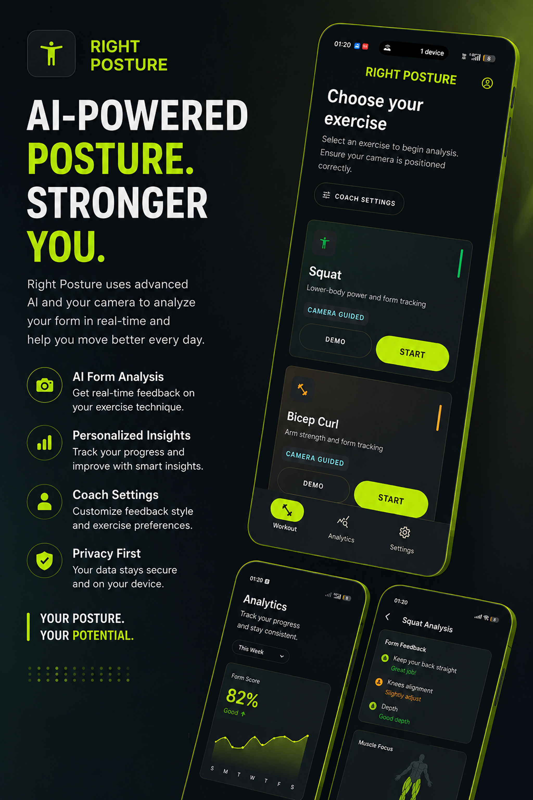

# Right Posture

### A private, real-time movement coach for your phone, with a Serverpod backend for workout history and progress.

<p align="center">
  
</p>

Right Posture uses only the phone camera to coach exercise form. It turns 33 body landmarks into joint angles, rep phases, form evidence and live cues. It also catches form slowly getting worse as you tire, not just reps that are plainly wrong.

**Serverpod is the backend.** It handles accounts, a Postgres-backed workout history that follows you to any device, and a progress report the server computes from every synced workout. Video and pose data never leave the phone. Only small workout summaries are synced.

---

## The problem

At-home exercise lacks feedback. People finish every scheduled rep while unknowingly shortening their range, rushing the return, or losing form as they tire. Rep counters only tell you *that* you moved. Right Posture shows *how* you moved and how that changes across sets, workouts and devices.

**Who it's for:** anyone training at home without a coach who wants to know whether their squats, curls, raises and presses are actually getting better.

## What it does

| On the phone (real time, offline) | On the Serverpod backend |
|---|---|
| ML Kit pose detection, 33 landmarks | Email accounts and one-tap guest accounts (Serverpod auth) |
| Confidence filtering, side locking, smoothing | Idempotent workout upload, stored once per workout |
| Rep state machines: squat, bicep curl, shoulder press (+ lateral raise preview) | Postgres tables for workouts and per-set metrics |
| Two-layer evaluation: immediate faults + gradual decline from a per-set baseline | History restore on a new phone or after reinstall |
| Live visual, voice, sound and haptic coaching | **Server-computed progress report**: streaks, weekly volume, best set, top issue, trend insights |
| Set summary, workout comparison, local analytics | Per-user data isolation, journal-note sync, delete-my-data |
| Coach tab: create/revoke links, read feedback, open an athlete's code | **Coach sharing**: unguessable share links, a server-rendered coach web page, coach feedback notes with read state, view counts |

### Flow

**Sign in (email or guest account, or offline only)** → **Workout** tab: choose exercise → guided demo → position phone → 3-2-1 → live coaching → set summary → workout summary → **auto-sync to Serverpod** → **Progress** tab (history and analytics) → **Coach** tab (share a live link with a coach, read their feedback) → **Profile** tab (cloud backup and the server progress report).

## Architecture


The key design choice is **one shared Dart package, `right_posture_core`**, used by both the app and the server. The server's progress report runs the exact analytics code the app uses, so the numbers always agree.

### Repository layout

```text
right_posture_core/     Pure-Dart movement + analytics engine (shared by app and server)
right_posture_server/   Serverpod server: models (.spy.yaml), endpoints, migrations, tests
right_posture_client/   Generated Serverpod client (do not edit)
right_posture_flutter/  Flutter Android app
```

### Serverpod pieces

| Piece | File |
|---|---|
| `WorkoutRecord` / `WorkoutSetRecord` tables with relation, cascade delete and unique `(authUserId, clientId)` index | `right_posture_server/lib/src/workouts/*.spy.yaml` |
| `WorkoutEndpoint`: `upload` (transactional, idempotent, validated with core), `list`, `status`, `updateNote`, `deleteAll` | `right_posture_server/lib/src/workouts/workout_endpoint.dart` |
| `ProgressEndpoint.report(utcOffsetMinutes)` → `ProgressReport` | `right_posture_server/lib/src/progress/` |
| Email + anonymous identity providers, JWT tokens | `right_posture_server/lib/server.dart`, `lib/src/auth/` |
| `CoachShare` / `CoachNote` tables; `CoachEndpoint` (create/list/revoke links, notes, mark read) and public `CoachViewEndpoint` (view by code, leave note) | `right_posture_server/lib/src/coach/` |
| Server-rendered coach page on the Serverpod web server (`/coach/:code`, GET view + POST feedback form) | `right_posture_server/lib/src/coach/coach_web_route.dart` |
| Offline-first sync client | `right_posture_flutter/lib/cloud_sync.dart` |
| Sign-in gate, tab shell, profile and coach screens | `right_posture_flutter/lib/ui/auth_gate.dart`, `ui/home_shell.dart`, `ui/account_page.dart`, `ui/coach_page.dart` |

## Privacy by design

| Data | Leaves the phone? |
|---|---|
| Camera frames, pose landmarks, raw angle streams | **Never** |
| Bounded workout summaries (rep counts, scores, issue labels, notes) | Only when signed in, to your own account |
| Progress report via coach link | Only to people you give a link; revocable at any time |

Users can delete their whole cloud backup from the Account screen.

## Run it

### Requirements
- Flutter 3.44.4+ (Dart 3.12.2+). Tested with Flutter 3.47.5.
- Serverpod CLI 4.0.4: `dart install serverpod_cli`
- An Android device (API 24+) with a camera. Pose detection needs a physical device.

### Local
```bash
cd right_posture_server
serverpod start            # embedded Postgres, applies migrations, hot reload
```
In a second terminal, run the app on a phone that can reach your computer:
```bash
cd right_posture_flutter
flutter run --dart-define=SERVER_URL=http://<your-computer-ip>:8080/
```
In development, email verification codes are printed in the server console.

### Against the hosted server
The app defaults to the deployed Serverpod Cloud API (`https://right-posture.api.serverpod.space/`, set in `right_posture_flutter/assets/config.json`):
```bash
cd right_posture_flutter
flutter run --release
```

### Tests
```bash
cd right_posture_server && dart test      # endpoint integration tests (embedded Postgres)
cd right_posture_flutter && flutter test  # 174 app tests incl. cloud sync
```
Smoke-test any running server end to end (guest sign-in, upload, de-dup, report):
```bash
cd right_posture_client && dart run tool/smoke.dart http://localhost:8080/
```

## Testing instructions for judges
1. Install the APK from the latest GitHub release (Android, camera permission required).
2. Tap **Continue without account** (a guest account, no email needed) or sign up with email. Use mobile data or an open network; some corporate firewalls block new domains.
3. Pick **Squat**, follow the setup guide, and do a short set. Then tap **End set** → **Finish workout**.
4. Open the **Profile** tab to see the sync status and the **Cloud progress report** computed by Serverpod.
5. Open the **Coach** tab → **Create coach link**, open the copied link in a browser (the coach view), and send feedback from that page. It appears in the app's Coach tab with a badge.

## Built with
Flutter · Dart · Serverpod 4 (endpoints, ORM, migrations, auth IdP, Serverpod Cloud) · PostgreSQL · Google ML Kit Pose Detection · Riverpod · fl_chart

### AI tools
Built with help from AI coding assistants (Claude Code), as the hackathon rules allow. They were used for code generation, refactoring, tests and documentation.

## Responsible claims
Right Posture is a movement and exercise-form coach, not a medical device. It doesn't diagnose injuries or replace a physiotherapist.
